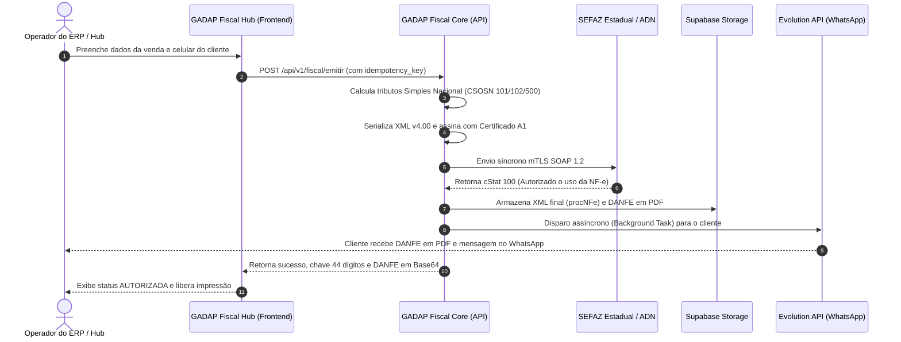

# Manual do Usuário e Guia Operacional - GADAP Fiscal Hub

**Versão da Plataforma:** 1.0.0  
**Enquadramento Fiscal Suportado:** Simples Nacional (CRT = 1)  
**Modelos Fiscais Suportados:** NF-e (Modelo 55), NFC-e (Modelo 65), NFS-e Padrão Nacional (ADN)  
**Infraestrutura:** GADAP Fiscal Core (FastAPI / Supabase / Evolution API v2.3.7)

---

## 1. Visão Geral da Solução

O **GADAP Fiscal Hub** é o centro operacional web unificado projetado para empresas optantes pelo Simples Nacional emitirem, monitorarem, gerenciarem e despacharem documentos fiscais eletrônicos com **idempotência estrita**, conformidade fiscal perante as 27 Secretarias de Fazenda estaduais (SEFAZ Multi-UF) e entrega multicanal automática via **WhatsApp (Evolution API)**.

---

## 2. Estrutura de Telas e Módulos

### 2.1. Dashboard Operacional (`/`)
* **Indicadores Principais (KPIs):**
  * Total de Notas Fiscais emitidas no mês corrente.
  * Valor total bruto e líquido faturado acumulado.
  * Notas fiscais autorizadas, canceladas e rejeitadas.
* **Monitor de Serviços SEFAZ:**
  * Indicador em tempo real da operabilidade dos WebServices de cada Unidade Federativa (SP, RJ, MG, BA, RS, etc.).
* **Alerta Preventivo do Certificado Digital A1:**
  * Contador regressivo de dias para expiração do certificado ICP-Brasil em uso.
  * Níveis de alerta: Verde (> 30 dias), Amarelo (15 a 30 dias) e Vermelho (< 15 dias).

---

### 2.2. Central de Notas Fiscais (`/notas`)
* **Listagem Inteligente:** Tabela com paginação, ordenação e filtros dinâmicos por:
  * Número do Documento e Série.
  * Chave de Acesso (44 dígitos).
  * CPF/CNPJ e Razão Social do Destinatário.
  * Status: `AUTORIZADA`, `REJEITADA`, `CANCELADA`, `EM_PROCESSAMENTO`.
* **Ações Disponíveis por Nota:**
  * **Visualizar / Baixar DANFE (PDF):** Visualização imediata do DANFE oficial com código de barras, marca d'água de homologação automática e dados tributários.
  * **Download do XML Autorizado (`procNFe`):** Arquivo XML íntegro com a assinatura digital ICP-Brasil e o protocolo de autorização SEFAZ anexado.
  * **Reenvio de WhatsApp:** Botão para reenviar o DANFE e resumo da nota via Evolution API para qualquer número com DDD.

---

### 2.3. Diagnóstico de Rejeições (`/rejeicoes`)
* **Guia Inteligente de Correções SEFAZ:**
  * Catálogo pesquisável dos principais códigos `cStat` (ex: 204 - Duplicidade, 539 - Chave duplicada, 232 - IE do destinatário não informada, 778 - NCM inexistente).
  * Explicação detalhada em **linguagem humana simples** para operadores que não dominam legislação tributária.
  * **Plano de Ação Passo a Passo:** Instruções diretas sobre como corrigir cadastros de produtos ou clientes no ERP antes de retransmitir.

---

### 2.4. Fechamento Contábil Mensal (`/contabil`)
* **Exportação em Lote (.ZIP):**
  * Agrupamento automático de todos os arquivos XML (`procNFe`) e DANFEs em PDF emitidos no mês/ano selecionado.
  * Nome do arquivo padronizado: `Fechamento_Contabil_MM_AAAA_<CNPJ>.zip`.
  * Elimina a necessidade de envio manual de notas fiscais ao escritório contábil.
* **Relatório Sintético:**
  * Total de faturamento do período discriminado por CFOP e CST/CSOSN para apuração do PGDAS-D.

---

### 2.5. Central de Ajuda e Manuais (`/ajuda`)
* **Base de Conhecimento Integrada:**
  * Guias de emissão para Venda no Balcão (NFC-e), Venda Interestadual (NF-e com Partilha de ICMS / Difal) e Prestação de Serviços (NFS-e ADN).
  * FAQ com as dúvidas mais frequentes de operadores.
  * Diagnóstico do status de integração da Evolution API (WhatsApp) e Supabase Storage.

---

### 2.6. Configurações do Sistema (`/configuracoes`)
* **Parâmetros da Empresa Emitente:**
  * CNPJ, Inscrição Estadual, Razão Social, Regime Tributário (CRT 1).
  * Endereço físico e alíquota média de ICMS Simples Nacional.
* **Certificado Digital A1:**
  * Visualização das credenciais, autoridade certificadora e data limite de validade.
* **Canais de Notificação:**
  * Ativação e configuração da instância da Evolution API (WhatsApp).

---

## 3. Fluxo Operacional: Passo a Passo de Emissão

---

## 4. Política de Contingência e Resiliência
1. **Idempotência Absoluta:** O envio repetido da mesma requisição com a mesma `idempotency_key` nunca gera notas duplicadas perante o fisco.
2. **Rejeição com Preservação:** Notas rejeitadas pela SEFAZ mantêm o histórico do `cStat` gravado para auditoria e retificação imediata.
3. **Resiliência do WhatsApp:** Falhas temporárias de conexão no WhatsApp não bloqueiam a autorização nem a impressão física da nota. O operador pode utilizar o botão "Reenviar WhatsApp" a qualquer momento.
